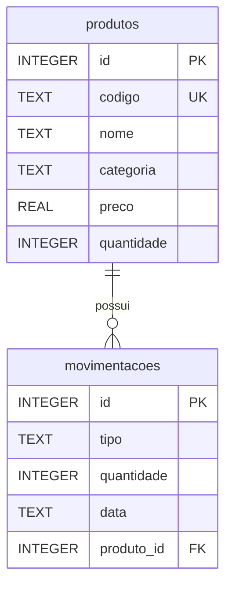

# Controle de Estoque

Aplicação web local para cadastrar produtos, registrar compras e saídas, acompanhar o estoque e consultar relatórios. Desenvolvida em Python, Flask e SQLite.

## Requisitos

- Python 3.10 ou superior
- pip

## Instalação e execução

```bash
python -m venv .venv
source .venv/bin/activate  # Windows: .venv\Scripts\activate
pip install -r requirements.txt
python app.py
```

Abra [http://127.0.0.1:5000](http://127.0.0.1:5000). O banco `instance/estoque.db` e suas tabelas são criados automaticamente na primeira execução. Para encerrar, use `Ctrl+C`.

## Funcionalidades

- Cadastro de produtos com código único, nome, categoria e preço.
- Registro de entradas (compras) e saídas (vendas/uso), com data e validação de saldo.
- Consulta do estoque atual, busca e filtro por categoria.
- Dashboard com valor total em estoque e alerta de itens com até cinco unidades.
- Relatórios visuais de quantidade por categoria e histórico de movimentações.
- Exportação CSV do estoque; o filtro de categoria selecionado também é aplicado ao arquivo.
- Triggers SQLite atualizam o estoque automaticamente e impedem saídas acima do saldo disponível.

## Banco de dados

O script [`schema.sql`](schema.sql) contém a criação das tabelas, índices, restrições e triggers.



`movimentacoes.produto_id` referencia `produtos.id`. Cada movimentação tem quantidade positiva e tipo `entrada` ou `saida`. Triggers aplicam a movimentação ao saldo; uma saída que exceda o estoque é rejeitada pelo próprio banco.

## Testes

```bash
pip install -r requirements.txt
python -m unittest discover -s tests -v
```

## Configuração opcional

Para definir uma chave estável para as mensagens da sessão, configure a variável de ambiente `SECRET_KEY` antes de iniciar o servidor. Sem ela, uma chave aleatória é gerada a cada inicialização.
